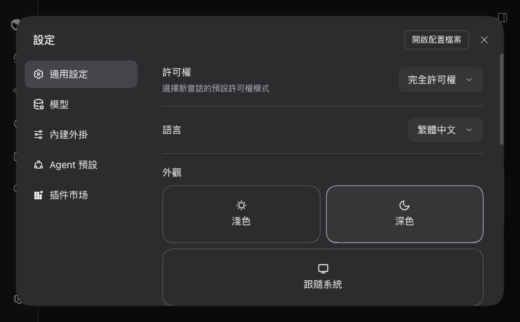

# dsh-zh-hant

繁體中文 language pack for [DeepSeek Harness](https://github.com/deepseek-ai/deepseek-harness)
(DSH). It adds a third language to the web GUI — `zh-Hant` — next to the shipped
`zh` (Simplified) and `en`, and puts it in **Settings → General → Language**.



Nothing in DSH is patched, no bundle is forked, and no other plugin is modified.
The locale service in `@deepseek-ai/dsh-client-locale` is explicitly extensible,
so Traditional Chinese is a plugin: it registers one language definition and one
dictionary per namespace, and the running app picks both up immediately.

## Install

```bash
dsh plugin add dsh-zh-hant            # from npm
dsh plugin add file:./plugins/dsh-zh-hant   # from a local checkout
```

Then choose **繁體中文** in Settings → General → 語言.

**The `dsh web` host must be running with the plugin already installed.** A
server started *before* `dsh plugin add` keeps serving the client module graph it
built at boot, so the language does not appear until it is restarted. If the
Plugins panel lists the plugin but the Language menu does not, that is why.

## What it covers

62 namespaces, 2,699 keys, ~90 KB — every dictionary the installed web GUI
registers, including the experimental features and the third-party plugins that
opt into `ctx.locale`.

| | |
|---|---|
| Settings | 設定 · 通用設定 · 模型 · 外觀 · 字號大小 · 快捷鍵 … |
| Conversation | 發送 · 插話發送 · 排隊發送 · 停止生成 · 軌跡 · 差異 |
| Sidebar | 摺疊側邊欄 · 新建會話 · 封存 · 刪除會話 · 工作區 |
| Files / preview | 檔案預覽 · 影像預覽 · PDF 預覽 · 沒有可預覽的檔案類型 |
| Plugins, schedules, agents | 外掛 · 提醒 · 子代理 · 預設權限 · 軌跡檢視 |

## What it does not cover

This is a language pack for DSH's **own** interface. It deliberately does not
reach into anything else:

- **Other plugins' hardcoded copy.** `dshmarket` never calls `ctx.locale`, so its
  panel title stays 「插件市场」. Editing that plugin's source is not this
  package's business — a plugin that wants Traditional Chinese registers its own
  dictionaries.
- **Copy captured outside the dictionary** — plugin titles from package
  manifests (`ctx.locale.resolveText`), command descriptions read once at
  registration time.
- **Model output, file contents, and anything the user typed.**

## How the dictionaries are built

The web GUI has ~2,700 keys and DeepSeek ships new ones every release, so the
dictionary is generated from the `zh` values the **installed** build already
contains, never hand-maintained:

```
scripts/extract-locales.mjs   read every ctx.locale.register() call site out of
                              the installed client bundles (shorthand consts,
                              esbuild-renamed consts, object spread and all)
        │
        ▼
scripts/build-dictionaries.mjs  OpenCC cn → tw → twp, per value
        │
        ▼
lib/client.js                 src/client.js with the literal spliced in
```

Rebuild after a DSH upgrade:

```bash
npm install                      # opencc-js, build-time only
npm run build                    # → lib/client.js
npm test                         # behaviour + conversion checks
```

`npm run build:tw` and `npm run build:t` produce the character-only variants if
you prefer 設置/文件 to 設定/檔案.

Two details that are easy to get wrong:

- **A single `cn → twp` pass is not a fixed point.** `STPhrases` rewrites 发送 to
  發送 and `TWPhrases` then finds nothing Simplified left, so 待发送附件 comes out
  as 待發送附件 and only becomes 待傳送附件 on a *second* pass. Running
  `cn → tw` to completion and applying the variant pass afterwards is both more
  idiomatic and idempotent.
- **`fallback` is `zh`, not `en`.** A key this pack does not cover falls back to
  Simplified rather than English, which is the right failure mode for a
  Traditional reader — and it means a namespace added by a future release
  degrades instead of breaking.

## Tests

`npm test` checks the registration contract (one language, one dictionary per
namespace, the three-argument register form), that a `zh-Hant` id already owned
by another pack is a warning rather than a boot failure, that the key set matches
the installed bundles exactly, and that **no Simplified-only character survives**
the conversion.

## License

MIT
